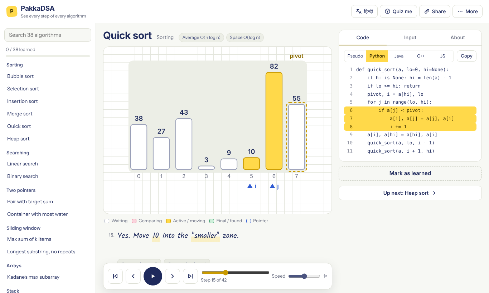
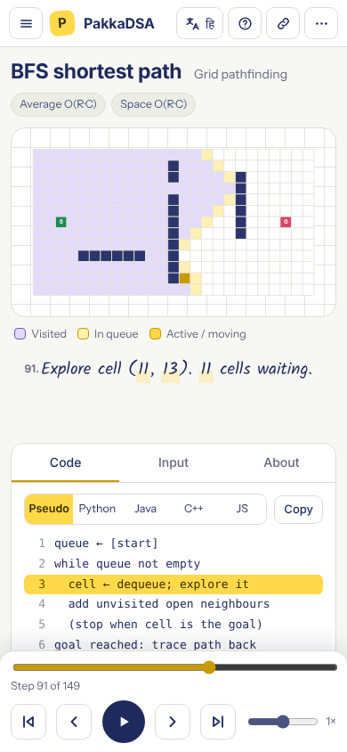
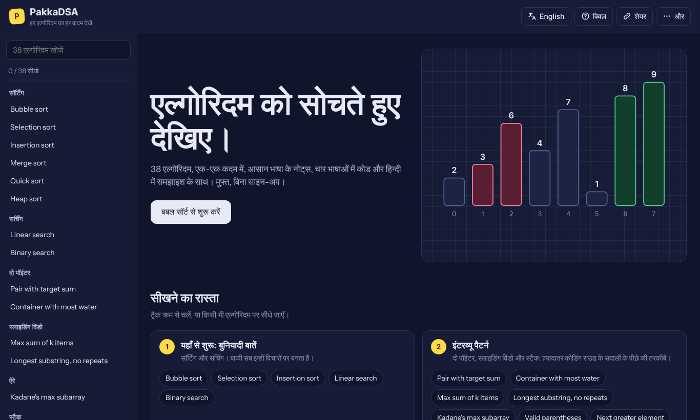

# PakkaDSA

**Watch an algorithm think.** Free, open-source algorithm visualizer: 38 algorithms one step at a time, with plain-language explanations in English and हिन्दी, real code in Python, Java, C++ and JavaScript, and a predict-the-next-step quiz. No signup, no tracking.

[Report a bug](../../issues/new?template=bug_report.md) · [Request an algorithm](../../issues/new?template=new_algorithm.md) · [Help translate](../../issues/new?template=translation.md)



| On a phone                                                         | हिन्दी, dark mode                                                          |
| ------------------------------------------------------------------ | -------------------------------------------------------------------------- |
|  |  |

## Features

- 38 algorithms across sorting, searching, two pointers, sliding window, arrays, stacks, linked lists, trees, heaps, graphs, grid pathfinding, dynamic programming and backtracking, in a 7-track learning path
- Items **slide** between steps; step back, scrub, jump, and change speed (0.25×–4×)
- Pseudocode plus Python, Java, C++ and JavaScript, with the current line highlighted; every snippet is real code that runs in the test suite
- Change the input; draw walls and move the start and goal on the pathfinding grid
- "Quiz me": predict the next step
- English and Hindi everywhere, including every step explanation; optional narration with your browser's voices
- Classroom mode for projectors; works on a 390 px phone; installable and works offline
- Share a link to an exact step and input, or save the current step as an image
- Every algorithm page is readable without JavaScript: explanation, complexity, pseudocode, four code listings and FAQs

## Privacy

No accounts, no analytics, no cookies, and no requests to other sites: every font, script and image is served from the site itself, and a test fails if any page contacts another origin. Your progress and settings (what you marked as learned, language, theme, speed) stay in your browser's local storage. Share links keep the input after `#`, which browsers never send to a server.

## Other visualizers

VisuAlgo and Algorithm Visualizer are great tools. PakkaDSA focuses on Hindi step explanations, an interview-pattern learning path, real code in four languages next to the animation, and predicting the next step.

## Run locally

```bash
git clone https://github.com/theanwerfaiz/PakkaDSA.git
cd PakkaDSA
npm ci
npm run dev
```

Node 22.12 or newer. Build with `npm run build` (static files in `dist/`).

| Command                  | What it does                                                                              |
| ------------------------ | ----------------------------------------------------------------------------------------- |
| `npm test`               | Unit tests: engine, renderers, content, i18n                                              |
| `npm run check:golden`   | Every step of every algorithm, and every drawing, against the recorded fixtures           |
| `npm run check:snippets` | Runs the code snippets in Python, JavaScript, Java and C++ (needs Python 3, JDK 17+, g++) |
| `npm run test:e2e`       | Browser tests (Chromium, Firefox, WebKit, phone)                                          |
| `npm run lighthouse`     | Performance, accessibility, best-practice and SEO scores on the built site                |
| `npm run check:all`      | Everything a pull request must pass                                                       |

## Deploy

The site is plain static files, so any static host works.

- **Cloudflare Pages:** build command `npm run build`, output directory `dist`, environment variable `PUBLIC_SITE_URL` set to your domain. Security headers come from `public/_headers`.
- **GitHub Pages:** run the "Deploy to GitHub Pages" workflow from the Actions tab (it builds and publishes `dist/`), after enabling Pages with "GitHub Actions" as the source. GitHub Pages ignores `_headers`; the same Content-Security-Policy is also set in every page.

Copy `.env.example` to `.env` to set the site URL and the optional source and sponsor links.

## Contribute

New algorithms, code languages, translations and fixes are welcome. See [CONTRIBUTING.md](CONTRIBUTING.md) and [docs/ADDING_AN_ALGORITHM.md](docs/ADDING_AN_ALGORITHM.md). The Hindi text has not yet been reviewed by a native speaker; corrections are especially welcome.

## Support

Free forever. If it helped you, ⭐ star the repo.

## Licence

Code: MIT © 2026 Faiz Anwer. Fonts in `public/fonts/` are under the SIL Open Font License; see the licence files next to them.
